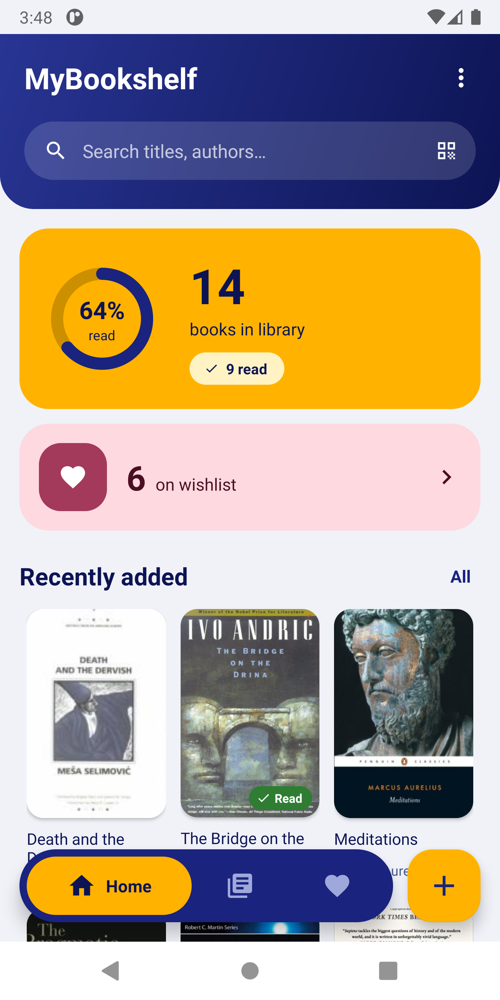
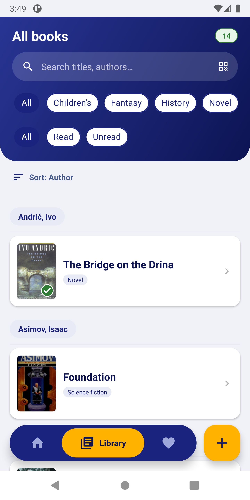
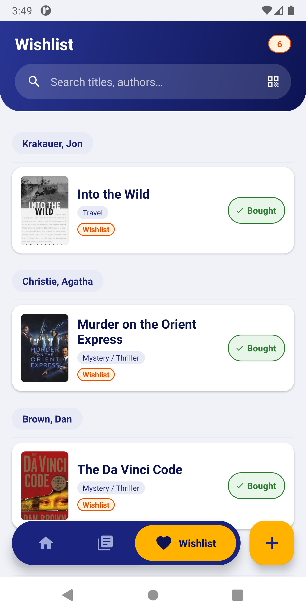
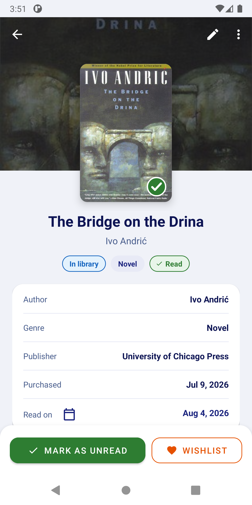
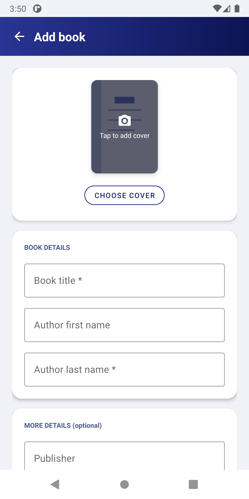
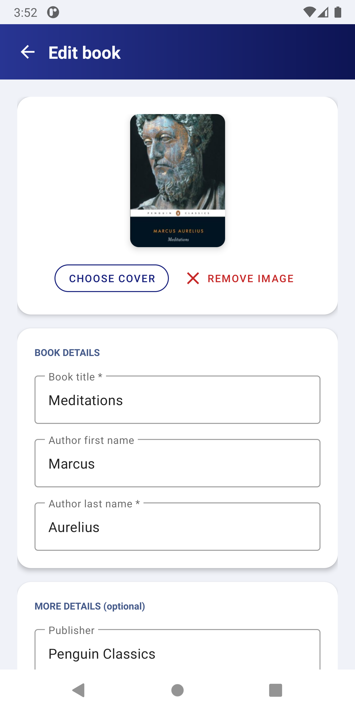

# MyBookshelf

A personal library manager for Android. Keep track of the books you own and the ones you want to buy,
add them by scanning the barcode, and browse your collection by author or genre.

> The interface is in **English**. All user-facing text lives in `app/src/main/res/values/strings.xml`
> (plus the genre names in `GenreConstants.java`), so adding another language is a small job.

## Screenshots

<table>
  <tr>
    <td align="center"><br>Home</td>
    <td align="center"><br>All books</td>
    <td align="center"><br>Wishlist</td>
  </tr>
  <tr>
    <td align="center"><br>Book details</td>
    <td align="center"><br>Add book</td>
    <td align="center"><br>Edit book</td>
  </tr>
</table>

## Features

- **Library and wishlist** – two separate lists, with one tap to move a book from the wishlist to the library
- **Barcode / QR scanning** – scan an ISBN and the book's title, author, publisher and cover are filled in automatically
- **Two lookup sources** – Google Books first, Open Library as an automatic fallback (no API key required)
- **Manual entry** – for books no database knows; optional cover picked from the gallery
- **Edit a book** – fix the title, author, genre or cover from the pencil icon on the details screen
- **Search** – by title or author, ignoring diacritics (`andric` finds `Andrić`)
- **Genre filter** – library grouped by author, sorted alphabetically (also correct for Serbian letters)
- **Offline-first** – everything is stored locally in a Room (SQLite) database; internet is only needed for ISBN lookup

## Tech stack

Java · AndroidX · MVVM (ViewModel + LiveData) · Room · ViewBinding · ConstraintLayout · Material Components ·
Glide · OkHttp · ZXing (`zxing-android-embedded`)

- `minSdk 24`, `targetSdk 34`
- Package layout: `activities`, `fragments`, `adapters`, `viewmodel`, `repository`, `database`, `models`, `utils`

## Getting started

Requirements: Android Studio (Hedgehog or newer), JDK 17 (bundled with Android Studio), Android SDK 34.

1. Clone the repository and open the folder in Android Studio (**File > Open**).
2. Wait for **Gradle Sync** to finish.
3. Pick a device or emulator (API 24+) and press **Run**.

Scanning needs a camera; on an emulator enable the virtual camera (Device Manager > Edit > Show Advanced Settings).

### Optional: Google Books API key

Without a key Google Books may answer with HTTP 429 (too many requests); the app then falls back to Open Library.
To use your own key, create a file named `local.properties` in the project root (it is git-ignored) and add:

```properties
GOOGLE_BOOKS_API_KEY=your_key_here
```

Restrict the key to the **Books API** in Google Cloud Console. Do not set an "Android apps" application restriction –
the app does not send the package/certificate headers that restriction requires.
See `local.properties.example`.

## Known limitations

- Book data for some regional publishers is missing in free databases; use manual entry (the scanner offers a web search shortcut).
- Search does not match Cyrillic and Latin spellings of the same name.
- The ISBN is not stored with the book yet.
- No backup/export of the library yet.

## License

[MIT](LICENSE)
